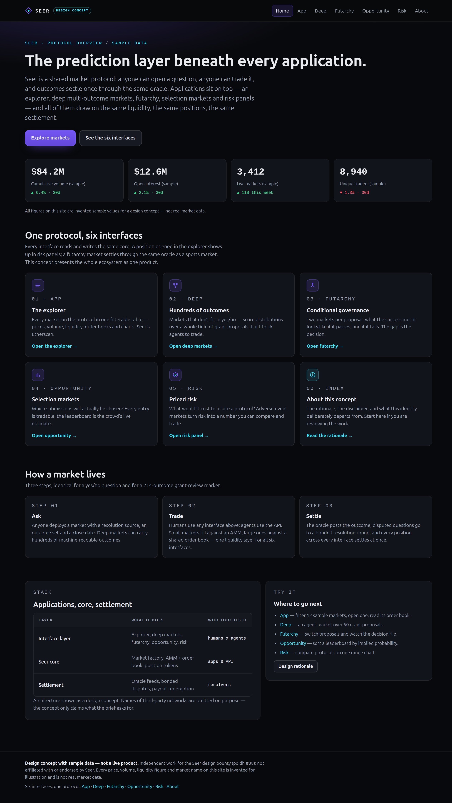

# Seer — six connected interfaces

An independent **design concept** exploring how Seer's six interfaces could look, read and
behave as a single product. Built for the *Design Seer's Six Interfaces* bounty on
poidh.xyz (bounty #38).

> **Design concept with sample data — not a live product.**
> Not affiliated with or endorsed by Seer. Every price, volume, liquidity figure, market,
> proposal, entry and agent on these pages is invented for illustration and is not real
> market data.

## Pages

| # | Interface | Page | What it shows |
|---|-----------|------|----------------|
| 1 | Home | [index.html](https://italeex.github.io/seer-six-interfaces/) | The protocol beneath the applications; the whole ecosystem on one page |
| 2 | App | [app.html](https://italeex.github.io/seer-six-interfaces/app.html) | Explorer: filterable market table, detail panel, SVG price chart, order book |
| 3 | Deep | [deep.html](https://italeex.github.io/seer-six-interfaces/deep.html) | Hundreds-of-outcomes markets, including an agent market over 50 grant proposals |
| 4 | Futarchy | [futarchy.html](https://italeex.github.io/seer-six-interfaces/futarchy.html) | Pass-vs-fail conditional markets on a success metric, with a decision summary |
| 5 | Opportunity | [opportunity.html](https://italeex.github.io/seer-six-interfaces/opportunity.html) | Selection markets: a leaderboard of entries with implied probabilities |
| 6 | Risk | [risk.html](https://italeex.github.io/seer-six-interfaces/risk.html) | Protocol risk estimates: comparison table, ranges and a range chart |
| — | About | [about.html](https://italeex.github.io/seer-six-interfaces/about.html) | Rationale, disclaimer and brand-kit notes |

## Preview

## Stack

Plain HTML, one shared `style.css`, vanilla JS. No build step, no CDNs, no webfonts, no
trackers, zero external requests. All charts are inline SVG drawn at runtime from the
sample data in each page.
